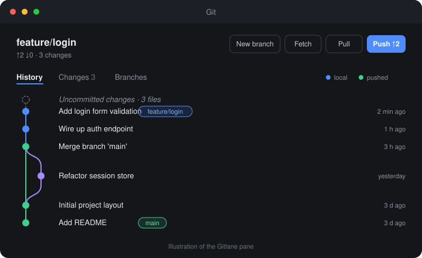
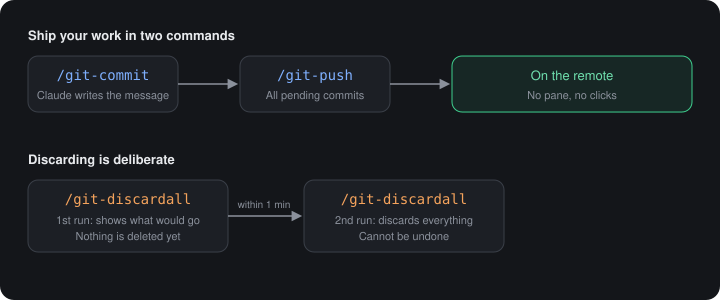

<div align="center">

# Gitlane

**Git, without leaving the conversation.**<br>
A pane and one-step commands for [Claude Code](https://claude.com/claude-code): commit with a suggested message, push, and discard.

[](LICENSE)
[](#installation)
[](.claude-plugin/plugin.json)

[Features](#features) · [Installation](#installation) · [Usage](#usage) · [Commands](#commands)

<br>



</div>

<br>

## Features

- **History graph.** Branch lanes, merges, and a marker for what is already on the remote and what only exists locally. Open a commit to read its full message.
- **Changes tab.** Choose the files to include, write a message or let Claude write it, and commit.
- **Branches tab.** Switch, create, merge and delete branches, and check out remote branches.
- **Merge help.** When a merge conflicts, mark files resolved, abort, complete the merge, or hand it to Claude with **Resolve with Claude**.
- **Always current.** The pane refreshes by itself when Claude edits files, when a turn ends, and every 30 seconds.
- **One-step commands.** `/git-commit`, `/git-push` and `/git-discardall` work without opening the pane.

## Installation

Inside Claude Code:

```text
/plugin marketplace add sengermf-1/Gitlane
/plugin install gitlane@gitlane
```

Then start a new session, or run `/reload-plugins`.

**Requirements:** [Git](https://git-scm.com/downloads) available on your `PATH`.

## Usage

### The pane: `/git`

Run `/git` to open the pane. It opens by itself in later sessions too, until you close it by hand; `/git` brings it back.

| Tab | What it does |
| --- | --- |
| **History** | The commit graph. Open a commit for its message, copy its hash, load older commits, and search by text, author, branch or hash. |
| **Changes** | Every uncommitted file. Select all or none, discard one file, **Discard all…**, then commit. |
| **Branches** | Local and remote-only branches, with switch, merge and delete. |

The header always shows the current branch, how far ahead or behind it is, and the actions you reach for most: **New branch**, **Fetch**, **Pull** and **Push**. On a branch with no remote yet, Push publishes it.

### Commit with a suggested message

In the **Changes** tab, press **✦ Suggest & commit**. Claude reads the diff of the selected files and the conversation, writes the message, and the commit follows at once. You can also type a message yourself and press the commit button.

## Commands

<p align="center">
  
</p>

| Command | What it does |
| --- | --- |
| `/git` | Opens the pane. |
| `/git-commit` | Commits all current changes with a message Claude suggests. No pane needed. |
| `/git-push` | Pushes the current branch with all of its pending commits. |
| `/git-discardall` | Discards every uncommitted change. Asks you to run it again to confirm. |

Each command replies with the result in the conversation, for example `Committed a1b2c3d.`, or with the reason it could not run.

### About `/git-discardall`

Discarding cannot be undone, and untracked files are **deleted**. So the command works in two steps:

1. The first run changes nothing. It tells you how many changes would be thrown away and how many are untracked files.
2. Run it again within one minute to confirm. After that minute, it asks again.

Tracked files go back to the last commit (`HEAD`); untracked files are removed.

## Project layout

```text
.claude-plugin/   plugin and marketplace manifests
hooks/            commands, actions, git calls and the pane views
tests/            tests for the git logic
types/            type definitions for the mod API
docs/             illustrations used in this README
```

## License

[MIT](LICENSE) © Marcos Felipe Senger
